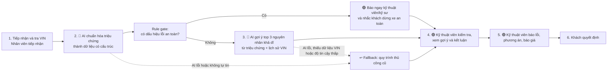

# 02 — Deep-Dive Report: VinFast, Kiểm tra và đánh giá sự cố xe

> **Lưu ý về số liệu:** Quy trình 6 bước và tổng thời gian khoảng 20 phút/xe lấy từ sơ đồ hiện trạng của nhóm. Thời gian từng bước và các con số tác động kinh doanh bên dưới là **ước tính giả định**, cần đo thực tế tại xưởng trước khi dùng để ra quyết định đầu tư.

---

# 🏗️ Phase 3 — DEEP-DIVE

## 3.1. Current-State Workflow

Quy trình kiểm tra và đánh giá sự cố xe hiện tại tại xưởng/trung tâm dịch vụ VinFast:

```mermaid
flowchart LR
    S1["1. Hỏi thông tin khách,<br/>tra VIN và lịch sử bảo dưỡng<br/>Nhân viên tiếp nhận<br/>⏱ ~2 phút"]
    S2["2. Hỏi khách về vấn đề của xe<br/>Nhân viên tiếp nhận<br/>⏱ ~3 phút"]
    S3["3. Quan sát, kiểm tra trực tiếp, chạy thử<br/>Kỹ thuật viên<br/>⏱ ~6 phút"]
    S4["4. 🔴 Đánh giá nguyên nhân từ kết quả<br/>kiểm tra và kinh nghiệm<br/>Kỹ thuật viên<br/>⏱ ~6 phút"]
    S5["5. Thông báo lỗi, phương án sửa, báo giá<br/>Kỹ thuật viên<br/>⏱ ~2 phút"]
    S6["6. Khách quyết định có sửa hay không<br/>Khách hàng<br/>⏱ ~1 phút"]
    S1 --> S2
    S2 -- "🔄 Handoff 1: chuyển thông tin xe và triệu chứng" --> S3
    S3 --> S4
    S4 --> S5
    S5 -- "🔄 Handoff 2: trao đổi phương án và báo giá" --> S6
    style S4 fill:#fde2e2,stroke:#c0392b,stroke-width:2px
```

| Bước | Ai làm | Việc | Thời gian (ước tính) | Ghi chú |
|---|---|---|---:|---|
| 1 | Nhân viên tiếp nhận | Hỏi thông tin khách, tra VIN và lịch sử bảo dưỡng | 2 phút | Tra cứu thủ công trên hệ thống |
| 2 | Nhân viên tiếp nhận | Hỏi khách về vấn đề của xe | 3 phút | Khách mô tả bằng lời đời thường, ghi chú tự do |
| 🔄 | | **Handoff 1:** chuyển thông tin xe và triệu chứng cho kỹ thuật viên | | Dễ mất hoặc sai thông tin |
| 3 | Kỹ thuật viên | Quan sát, kiểm tra trực tiếp và chạy thử | 6 phút | |
| 4 🔴 | Kỹ thuật viên | Đánh giá nguyên nhân từ kết quả kiểm tra và kinh nghiệm | 6 phút | **Bottleneck:** tự tổng hợp triệu chứng, lịch sử và kết quả kiểm tra |
| 5 | Kỹ thuật viên | Thông báo lỗi, phương án sửa và báo giá | 2 phút | |
| 🔄 | | **Handoff 2:** trao đổi phương án và báo giá với khách | | |
| 6 | Khách hàng | Quyết định có đồng ý sửa hay không | 1 phút | |

**Tổng cộng ≈ 20 phút/xe** (con số này từ sơ đồ nhóm; phân bổ từng bước là ước tính).

---

## 3.2. Problem Statement (6-field) và Metrics

| Field | Nội dung |
|---|---|
| **1. Actor / Operator** | Kỹ thuật viên dịch vụ VinFast (người đánh giá nguyên nhân) và nhân viên tiếp nhận (người thu thập triệu chứng). |
| **2. Current Workflow** | 6 bước thủ công: tiếp nhận thông tin và tra VIN, hỏi triệu chứng, kỹ thuật viên kiểm tra và chạy thử, tự đánh giá nguyên nhân dựa trên kinh nghiệm, báo lỗi kèm báo giá, khách quyết định. Tổng khoảng 20 phút/xe. |
| **3. Bottleneck** | Bước 4: kỹ thuật viên phải tự tổng hợp triệu chứng khách nói, lịch sử bảo dưỡng của VIN và kết quả kiểm tra để hình thành đánh giá sơ bộ. Chất lượng phụ thuộc kinh nghiệm cá nhân; thông tin dễ thất lạc ở Handoff 1. (Cần kiểm chứng bằng đo thời gian thực tế.) |
| **4. Business Impact** | Chưa có số đo thực. Công thức ước lượng: thời gian tiết kiệm mỗi ngày = số xe/ngày × số phút giảm được. Ví dụ giả định 50 xe/ngày/xưởng và giảm 8 phút/xe thì tiết kiệm khoảng 400 phút, tức gần 7 giờ làm việc mỗi ngày mỗi xưởng. Ngoài ra khách chờ ngắn hơn có thể cải thiện mức hài lòng (cần đo). |
| **5. Success Metric** | 1. Thời gian từ lúc nhận xe đến lúc có đánh giá sơ bộ giảm từ ~20 phút xuống dưới 12 phút/xe. 2. Nguyên nhân thật (kết luận cuối của kỹ thuật viên) nằm trong top 3 gợi ý của AI ở ít nhất 80% ca. 3. 100% ca có triệu chứng thuộc nhóm an toàn (phanh, lái, pin cao áp, túi khí, cháy) được báo cho kỹ thuật viên/kỹ sư phụ trách ngay, không bị AI xử lý như ca thường. |
| **6. Operational Boundary** | **AI được phép:** đọc VIN, lịch sử bảo dưỡng, ghi chú triệu chứng; chuẩn hóa triệu chứng thành dữ liệu có cấu trúc; gợi ý tối đa 3 nguyên nhân khả dĩ kèm câu hỏi/kiểm tra nên làm thêm; soạn nháp ghi chú. **AI tuyệt đối không được:** kết luận nguyên nhân cuối cùng; báo giá; quyết định hoặc tư vấn bỏ qua sửa chữa; nói xe "an toàn để chạy" với nhóm lỗi an toàn. **Phải có người duyệt:** mọi gợi ý đều do kỹ thuật viên xác nhận trước khi đưa vào phiếu và báo cho khách. |

---

## 3.3. Future-State Flow và AI Fit

### AI-Fit Matrix: chọn kiểu giải pháp nào?

| Tiêu chí | Rule / State-machine | LLM Feature | Agentic Loop |
|---|---|---|---|
| Đầu vào | Mã lỗi, từ khóa cố định | Mô tả triệu chứng tiếng Việt tự do | Nhiều bước, nhiều công cụ |
| Phù hợp cho | Phát hiện nhóm lỗi an toàn bằng từ khóa và mã lỗi | Chuẩn hóa triệu chứng, gợi ý nguyên nhân từ ngữ cảnh | Tự tra cứu, tự đặt lịch, tự báo giá |
| Rủi ro | Bỏ sót mô tả lạ | Gợi ý sai (kiểm soát bằng người duyệt) | Hành động sai không có người chặn, trong lĩnh vực an toàn xe |
| Kết luận | **Dùng làm cổng an toàn** | **Chọn làm lõi** | **Không chọn** |

**Quyết định:** **LLM Feature kết hợp Rule gate.** Rule chạy trước để bắt nhóm lỗi an toàn. LLM chỉ đóng vai trợ lý gợi ý. Không dùng Agentic Loop vì quy trình có cấu trúc cố định, và hành động sai liên quan an toàn xe (phanh, pin cao áp) có hậu quả lớn.

### Future-State Flow

**Chú thích:** 🔵 bước AI xử lý · 🟢 bước con người (Human-in-the-loop) · ↩️ phương án dự phòng.

**Cơ chế Human-in-the-loop:** kỹ thuật viên là người duy nhất kết luận nguyên nhân. Gợi ý của AI hiển thị kèm lý do ngắn (triệu chứng nào, lịch sử nào dẫn đến gợi ý). Kỹ thuật viên có thể bỏ qua hoặc sửa gợi ý, và lựa chọn đó được ghi lại để đo tỉ lệ top-3 đúng.

**Cơ chế Fallback:**
- AI lỗi, hết thời gian chờ hoặc trả sai định dạng: bỏ gợi ý, làm theo quy trình thủ công hiện tại.
- Không tìm thấy lịch sử VIN hoặc mô tả quá mơ hồ: AI chỉ nêu câu hỏi cần hỏi thêm, không đưa nguyên nhân.
- Có dấu hiệu lỗi an toàn: rule báo kỹ thuật viên ngay, bỏ qua LLM.

---

# 💻 Phase 4 — Prompt Prototype và Boundary Test

File `starter-code/prompt_prototype.py` của lab dùng sẵn tình huống mẫu của Xanh SM (hết pin, luật `[DRAFT_ONLY]` và ngưỡng pin 5%) để rèn kỹ thuật bảo vệ ranh giới bằng prompt. Nhóm làm theo mẫu này để thực hành kỹ thuật; nguyên tắc rút ra (AI chỉ soạn nháp, có luật cứng cho tình huống nguy hiểm, kiểm thử bằng prompt tấn công) cũng chính là cách áp dụng cho bài toán VinFast ở trên.

**Kết quả chạy thử:** [ĐIỀN SAU KHI CHẠY: số ca Passed, ca nào model phá luật, đã sửa prompt thế nào. Xem `03-ai-log.md`.]

---

# 🏁 Phase 5 — EVALUATE

### AI Readiness Checklist

| # | Tiêu chí | Trạng thái | Chứng cứ / Nhận xét |
|---|---|---|---|
| 1 | Có sẵn dữ liệu mẫu/logs sạch để test? | ❌ Chưa | Chưa có phiếu tiếp nhận và kết luận kỹ thuật viên đã ẩn danh. Chưa có baseline thời gian đo thực tế. |
| 2 | Rủi ro khi AI sai nằm trong tầm kiểm soát (HITL hoặc Fallback)? | ✅ Có | Kỹ thuật viên luôn kết luận; có rule gate cho lỗi an toàn; có fallback về quy trình cũ. |
| 3 | Stakeholders sẵn sàng thay đổi quy trình cũ? | ❓ Chưa xác minh | Chưa phỏng vấn kỹ thuật viên và cố vấn dịch vụ. Cần kiểm tra xem họ có chịu dùng gợi ý của AI không. |

### Quyết định: **NOT YET**

- [ ] **GO**
- [x] **NOT YET (Cần tích lũy thêm dữ liệu/xác lập baseline)**
- [ ] **NO-GO**

**Justification:**

Bài toán đáng làm vì có bottleneck rõ ở bước 4, đầu vào là ngôn ngữ tự nhiên (hợp với LLM) và rủi ro được kiểm soát bằng người duyệt cùng rule gate. Tuy vậy nhóm chưa nên bắt đầu xây prototype thật vì hai điều kiện còn thiếu:

1. **Chưa có baseline.** Các con số 20 phút/xe, 6 phút ở bước 4 và đích 12 phút đều là ước tính. Không có số đo thật thì không chứng minh được AI cải thiện hay không.
2. **Chưa có dữ liệu để kiểm tra độ chính xác.** Chỉ số "đúng trong top 3 ở 80% ca" cần tập phiếu cũ có kết luận của kỹ thuật viên. Chưa có tập này thì không thể đo.

**Điều kiện chuyển sang GO:**
- Đo thời gian thực tế ít nhất 30 lượt xe tại một xưởng để có baseline từng bước.
- Lấy được tập phiếu kiểm tra cũ đã ẩn danh (ít nhất vài trăm ca) và chạy thử LLM so với kết luận của kỹ thuật viên; đồng thời so sánh với một giải pháp rule/từ khóa đơn giản để chứng minh LLM đáng dùng.
- Phỏng vấn ít nhất 3 kỹ thuật viên và 2 nhân viên tiếp nhận để xác nhận họ muốn dùng gợi ý và đồng ý với cách ghi lại lựa chọn.
